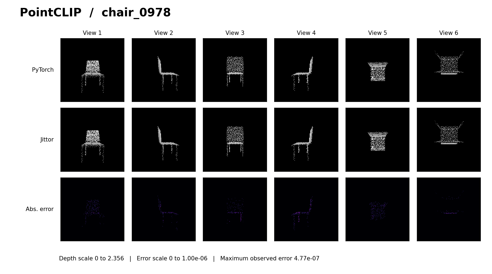

# PointCLIP 的 Jittor 复现

本仓库是 CVPR 2022 论文 *PointCLIP: Point Cloud Understanding by CLIP* 的课程复现。模型把物体的 1,024 个三维点投影成多张深度图，用 CLIP 对齐图像和类别文字。少样本分类时冻结两个编码器，只训练跨视角适配器。在 ModelNet40 的 2,468 个测试物体上，16-shot 自训的 Jittor 和 PyTorch 分别答对 **2,106** 和 **2,099** 个。[原论文](https://openaccess.thecvf.com/content/CVPR2022/html/Zhang_PointCLIP_Point_Cloud_Understanding_by_CLIP_CVPR_2022_paper.html) · [作者 PyTorch 仓库](https://github.com/ZrrSkywalker/PointCLIP)

## 从哪里开始

- **先看一把椅子**。下图将同一个物体在两个框架中的六张深度图逐像素对齐。六个方向的前景像素位置全部相同，最大深度差约为 4.77 × 10⁻⁷。[投影实现](src/pointclip_jittor/projection.py) · [六视角核查记录](results/chair/six_views.json)
- **用自己的电脑核对表格**。仓库附有两边训练出的分类器在每个测试物体上的前五个候选类别。安装 Python 3 后，在仓库根目录运行下面的命令即可核对五档 Top-1、Top-5 和两边预测一致数。核对已保存结果只用 Python 标准库。
- **用 GPU 运行模型**。先按[环境、数据和权重准备](docs/setup.md)配置 Linux 环境，再按[训练与评估命令](docs/experiments.md)运行八个物体的零样本推理、单把椅子的十视角核对或完整训练。

```sh
python tools/verify_results.py
```



## ModelNet40 实测结果

下表的每一档都由 Jittor 和 PyTorch 各自从随机初始化训练适配器。两边使用相同的训练物体、冻结的 RN101 图文特征、批次顺序、250 轮增强和学习率。种子为 2，采用最后一轮模型。单个种子的结果反映本次抽样。

| 每类标注数 | 训练物体 | Jittor Top-1 | PyTorch Top-1 | Jittor Top-5 | PyTorch Top-5 |
| ---: | ---: | ---: | ---: | ---: | ---: |
| 1 | 40 | 49.31% | 49.23% | 81.08% | 79.98% |
| 2 | 80 | 63.57% | 63.94% | 86.71% | 86.95% |
| 4 | 160 | 74.27% | 74.80% | 93.52% | 93.60% |
| 8 | 320 | 81.36% | 81.24% | 95.58% | 95.34% |
| 16 | 640 | **85.33%** | **85.05%** | **97.04%** | **97.00%** |

16-shot 的两种实现都更新了 5,000 次。末轮训练损失分别为 1.27499 和 1.27639，有 2,363 个测试物体得到相同的首选类别。[五档对照图](results/figures/shot_comparison.png) · [逐轮损失图](results/figures/loss_16shot.png) · [逐物体预测](results/predictions.csv) · [完整精度表](results/shot_comparison.csv)

| 其他对照 | Jittor Top-1 | PyTorch Top-1 | 输入与设置 |
| --- | ---: | ---: | --- |
| RN50 零样本，仓库默认 | 19.41% | 19.45% | 两边各自从原始点云推理，六视角等权 |
| RN50 零样本，论文表 1 配置 | 19.29% | 19.17% | 两边各自投影，使用表 1 固定的视角权重 |
| RN101 关闭适配器 | 9.60% | 9.60% | 两边共享同一套十视角特征 |
| RN101 加载作者适配器 | 86.59% | 86.59% | 共享特征与作者权重，2,468 个首选全部一致 |

五个自训 PyTorch 适配器也已接回作者的原始点云推理流程复测。各框架独立编码、共享冻结特征和复测的数值分别保存在[各协议汇总表](results/all_protocols.csv)。表中的百分比均来自本项目实跑。

## 仓库目录

| 目录 | 内容 |
| --- | --- |
| [src/pointclip_jittor](src/pointclip_jittor/) | 六视角与十视角投影、CLIP 图像与文本编码器、零样本打分、少样本适配器 |
| [scripts](scripts/) | 权重转换、特征提取、自训、评估和 PyTorch 对照入口 |
| [configs/environment](configs/environment/) 和 [requirements](requirements/) | CUDA 环境辅助脚本及 Python 依赖 |
| [manifests](manifests/) | seed 2 的 640 个训练物体 ID 和类别顺序 |
| [results](results/) | 逐物体排名、逐轮 loss、准确率、椅子案例和图表 |
| [tools](tools/) 和 [docs](docs/) | 结果核算工具、环境配置和实验手册 |

数据集、模型权重和作者固定版本源码在配置时获取。论文方法与 PyTorch 上游实现归原作者，预训练编码器来自 [OpenAI CLIP](https://github.com/openai/CLIP)。本项目在 Jittor 上实现前向计算、适配器训练与评估，并保留了对应的 PyTorch 实测对照。[数据与权重来源](docs/setup.md)
