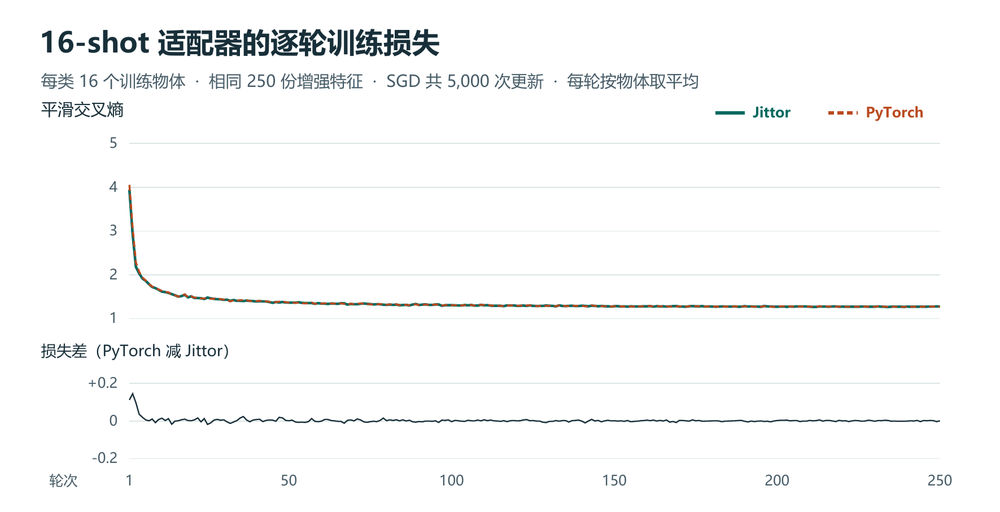

# PointCLIP-Jittor

PointCLIP V1（CVPR 2022）的 Jittor 实现，覆盖 ModelNet40 上的零样本和少样本点云分类。模型把每个物体的 1,024 个三维点投影为多视角深度图，用预训练 CLIP 编码图像和类别文本，再按相似度分类。[论文](https://openaccess.thecvf.com/content/CVPR2022/html/Zhang_PointCLIP_Point_Cloud_Understanding_by_CLIP_CVPR_2022_paper.html) · [作者实现](https://github.com/ZrrSkywalker/PointCLIP) · [OpenAI CLIP](https://github.com/openai/CLIP)

- **零样本分类**使用六个固定视角。RN50 编码器分别提取深度图特征，按视角权重与 40 个类别文本匹配。[几何投影](src/pointclip_jittor/geometry/) · [CLIP 编码器](src/pointclip_jittor/encoders/) · [零样本模型](src/pointclip_jittor/models/zeroshot.py)
- **少样本分类**使用十个视角。跨视角适配器接收十个 512 维 RN101 特征，联合建模各视角，再将适配后的特征与原始特征按 0.6 和 0.4 的比例融合。训练期间只更新适配器。[适配器](src/pointclip_jittor/models/adapter.py)

## ModelNet40 结果

测试集包含 40 类、2,468 个物体。零样本实验中，两个框架均从原始点云独立推理。

| 零样本配置 | 视角权重 | Jittor Top-1 | PyTorch Top-1 |
| --- | --- | ---: | ---: |
| 作者仓库默认配置，128 × 128 深度图 | 六视角等权 | 19.41% | 19.45% |
| 论文表 1 配置，121 × 121 深度图 | 3、9、5、4、5、4 | 19.29% | 19.17% |

少样本实验固定种子 2。每一档的两个框架共享冻结的图文特征、训练物体、批次顺序和学习率，各自从随机初始化训练 250 轮，使用末轮权重评估。

| 每类训练物体数 | Jittor Top-1 | PyTorch Top-1 | Jittor Top-5 | PyTorch Top-5 |
| ---: | ---: | ---: | ---: | ---: |
| 1 | 49.31% | 49.23% | 81.08% | 79.98% |
| 2 | 63.57% | 63.94% | 86.71% | 86.95% |
| 4 | 74.27% | 74.80% | 93.52% | 93.60% |
| 8 | 81.36% | 81.24% | 95.58% | 95.34% |
| 16 | **85.33%** | **85.05%** | **97.04%** | **97.00%** |

在相同的十视角 RN101 特征上，关闭适配器时两个框架的 Top-1 均为 9.60%，加载作者的 16-shot 适配器后均为 86.59%。独立训练的 16-shot 适配器分别答对 2,106 和 2,099 个测试物体。[完整评测结果](results/all_protocols.csv) · [逐样本排名](results/predictions.csv) · [250 轮训练损失](results/loss_16shot.csv)

[实验环境、数据与运行命令](docs/reproduction.md) · [训练样本名单](manifests/modelnet40_16shot_seed2.json) · [五档准确率曲线](results/figures/shot_comparison.png)
